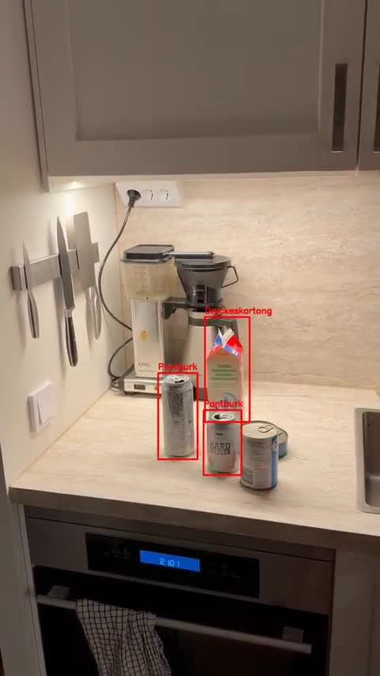
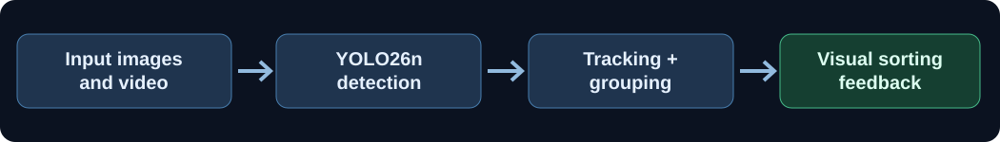
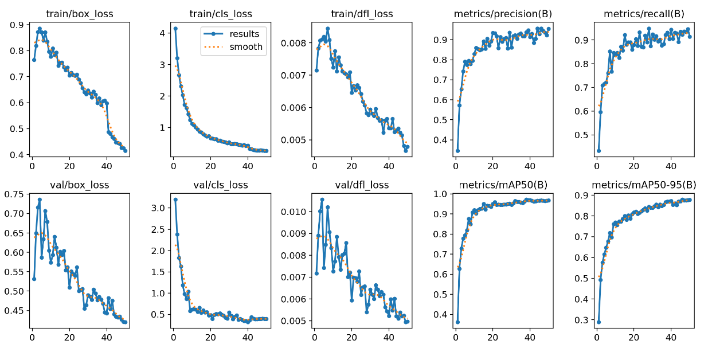
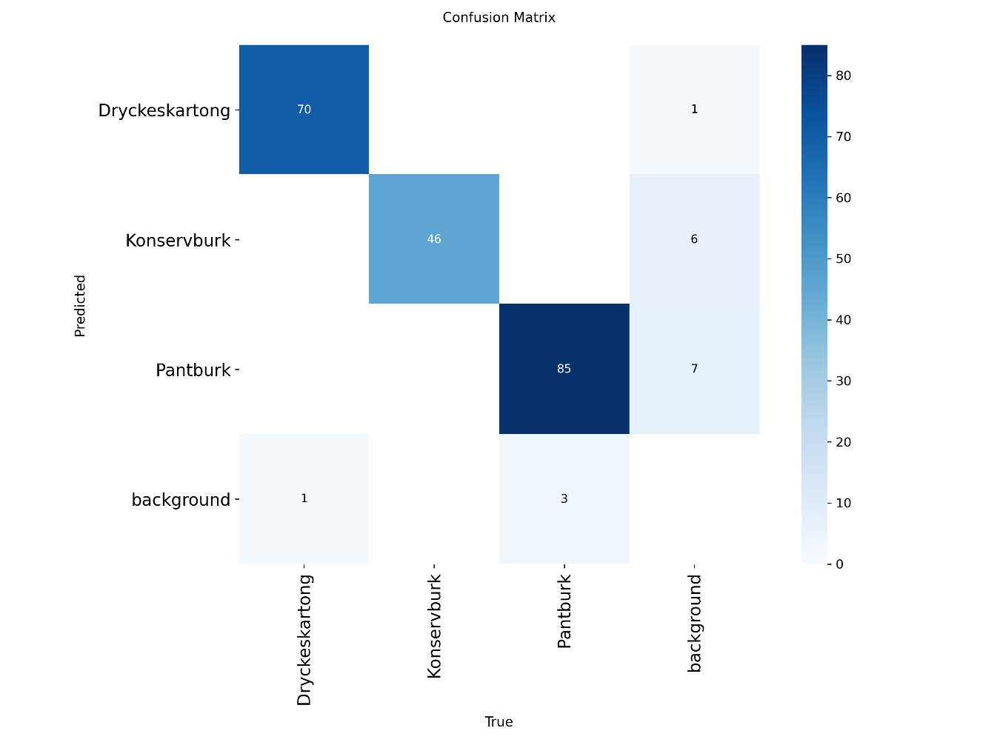
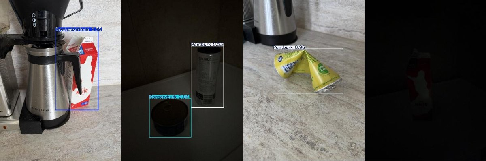

# Waste Sorting with Object Detection

**Python | Ultralytics YOLO | OpenCV | Google Colab**

This is a computer vision project I worked on during my IT studies at Arcada University of Applied Sciences. The idea was to train an object detection model to recognize different types of waste and then use the detections in an application that shows whether objects are sorted correctly.

I wanted to do more than just train a model, so I also built an application that processes images and videos and gives visual feedback based on the objects it detects.

## Video demonstration

This short video shows my trained model detecting waste objects and marking whether nearby objects belong to the same category.

**[Watch the full demonstration video (MP4)](assets/demo.mp4)**

## What I built

The model recognizes three types of waste:

- **Beverage cartons** (`Dryckeskartong`)
- **Food cans** (`Konservburk`)
- **Deposit cans** (`Pantburk`)

After detecting the objects, my application uses their positions to decide whether nearby objects belong to the same category. It draws bounding boxes around the objects and uses colors to show the result:

- **Green** – objects are grouped with the same type of waste
- **Red** – different types of waste are mixed together
- **Yellow** – an object is detected on its own

For video, I also used object tracking and smoothing to make the bounding boxes and status indicators more stable between frames. The sorting check is based on proximity and object classes; it is not a physical sorting system.

## Dataset and training

For the dataset, we collected and annotated images of the three waste categories. I used **Label Studio** to work with bounding boxes and exported the annotations in YOLO format.

I prepared the data in Google Colab and split it into training, validation and test sets, aiming for an **80/10/10 split**. The training notebook reports 528 training images, 66 validation images and 67 test images after matching images with their annotation files.

I trained an **Ultralytics YOLO26n** model on a **T4 GPU in Google Colab** for **50 epochs**, with an image size of 640 pixels.

## Results

These are the object detection results from my test run:

| Metric | Result |
|---|---:|
| Test images | 67 |
| Annotated objects | 205 |
| Precision | 0.954 |
| Recall | 0.967 |
| mAP50 | **0.988** |
| mAP50–95 | **0.891** |

I was happy with the results, especially how well the model could recognize the three categories in normal conditions. The most difficult distinction was between food cans and deposit cans, since they often look similar.

I also tested the model on **10 new, more challenging images**, including poor lighting and partially hidden objects. It handled most of them, but failed to detect objects in **2 very dark images**. This was a useful reminder that good test results do not mean the model will work equally well in every environment.

These metrics measure **object detection**, not the accuracy of the complete sorting application.

### Training performance

The graphs below show how the training losses and detection metrics changed over 50 epochs.

### Confusion matrix

I used the confusion matrix to see which object classes the model sometimes mixed up. Food cans and deposit cans were the most difficult to distinguish.

### Challenging lighting conditions

I also tested some more difficult images, including a very dark scene where the model struggled.

## Code and documentation

| File | What it contains |
|---|---|
| [Training and evaluation](notebooks/01_training_and_evaluation.ipynb) | Dataset preparation, YOLO training and evaluation |
| [Image sorting prototype](notebooks/02_image_sorting_prototype.ipynb) | My first version of the sorting logic using images |
| [Video tracking and sorting](notebooks/03_video_tracking_and_sorting.ipynb) | Video processing, tracking, grouping and visual feedback |
| [Technical report](docs/project_report.md) | More details on the dataset, training, results and application |
| [Original project report (PDF)](docs/Waste_sorting_model.pdf) | Training curves, evaluation and examples from my project |
| [Demonstration video (MP4)](assets/demo.mp4) | Annotated video output from my application |

I originally developed the project in **Google Colab**. I have cleaned up the notebooks for GitHub, but some file paths still refer to my original Drive folders.

## Running the project

If you want to try the notebooks in Colab:

1. Install the packages listed in `requirements.txt`.
2. For training, provide images and YOLO-format labels and update the Drive paths in the notebook.
3. Run the training notebook to prepare the dataset and train the model.
4. To test the image or video application, provide the trained `best.pt` checkpoint and an input image or video.

The full training dataset and trained checkpoint are **not included** in this repository, so the application cannot be run end-to-end without them.

## What I learned

This project helped me understand the full computer vision workflow: preparing a dataset, annotating images, training a model, measuring its performance and then using its predictions in an actual application.

The application also gave me experience with OpenCV, object tracking, distance calculations and handling video frame by frame. If I continue working on it, I would like to test it in more varied lighting conditions and evaluate the sorting decisions separately from the object detector.

---

**William Skogberg**  
IT student, Arcada University of Applied Sciences
